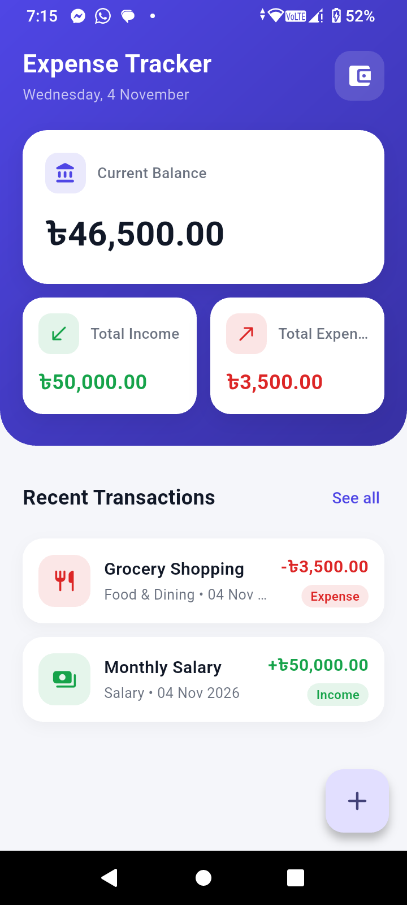
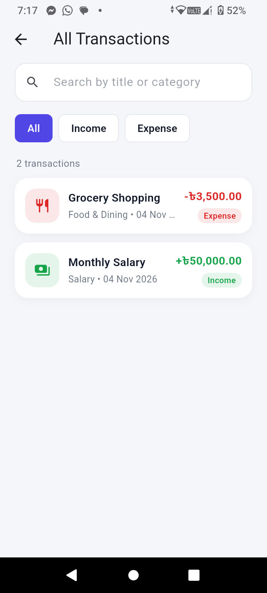
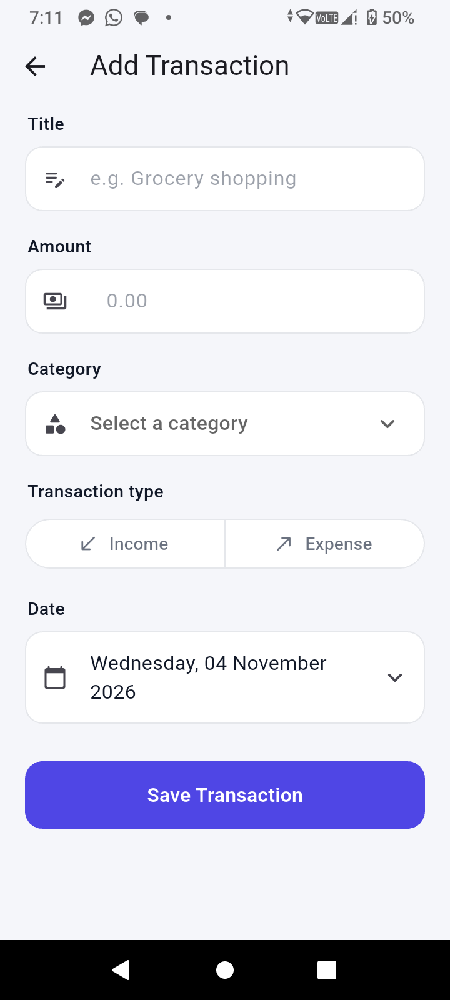
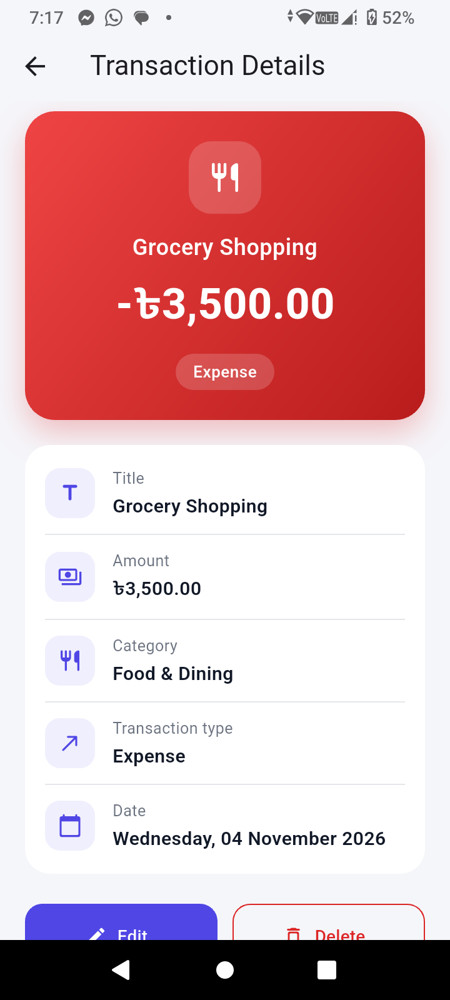

# 💰 Expense Tracker - Personal Finance & Budget App

[](https://flutter.dev/)
[](https://dart.dev/)
[](https://www.sqlite.org/)
[](LICENSE)

A modern, fast, and offline-first personal finance and expense management mobile application built with **Flutter**, **Provider**, and **SQLite (`sqflite`)**. Keep track of your daily incomes, categorize expenses, and monitor your current balance in real time with an elegant and intuitive user interface.

---

## 📱 App Screenshots

| Dashboard | All Transactions | Add Transaction | Transaction Details |
|:---:|:---:|:---:|:---:|
|  |  |  |  |

---

## ✨ Features

- 📊 **Real-Time Financial Dashboard:**
  - Dynamic display of **Current Balance**, **Total Income**, and **Total Expense**.
  - Overview of recent transactions with quick navigation to full history.

- 💾 **100% Offline & Private (SQLite):**
  - All financial data is stored locally on the device using `sqflite`.
  - Zero external cloud dependencies, ensuring total privacy and lightning-fast load times.

- 🔄 **Complete CRUD Functionality:**
  - **Create:** Easily add new incomes and expenses with title, amount, category, type, and date.
  - **Read:** Clear list views and detailed breakdown views for every transaction.
  - **Update:** Edit any existing record seamlessly.
  - **Delete:** Safe deletion flow with custom confirmation dialogs to prevent accidental loss.

- 🔍 **Search & Smart Filters:**
  - Instant live search by transaction title or category.
  - One-tap filter tabs for **All**, **Income**, and **Expense**.

- 🏷️ **Comprehensive Category Management:**
  - 12+ built-in categories (Salary, Food & Dining, Transport, Shopping, Bills & Utilities, Freelance, Health, Education, Entertainment, Investment, etc.).
  - Custom rounded Material icons and distinct badge colors for income and expenses.

- 🧪 **Unit-Tested:**
  - Built-in test coverage ensuring reliable serialization and model integrity.

---

## 🛠️ Tech Stack & Architecture

- **Framework:** [Flutter](https://flutter.dev/) (Channel stable, Material 3)
- **Language:** [Dart](https://dart.dev/)
- **State Management:** [Provider](https://pub.dev/packages/provider)
- **Local Storage:** [sqflite](https://pub.dev/packages/sqflite) & [path](https://pub.dev/packages/path)
- **Localization & Formatting:** [intl](https://pub.dev/packages/intl)
- **Testing:** `flutter_test`

### 📂 Project Structure

```text
lib/
├── core/
│   ├── app_theme.dart          # Colors, typography, and Material 3 theme configuration
│   ├── constants.dart          # App-wide constants, currency symbols, and category definitions
│   ├── formatters.dart         # Date and currency formatting helpers
│   └── snackbar.dart           # Reusable feedback notifications
├── database/
│   └── database_helper.dart    # SQLite database initialization, migrations, and CRUD operations
├── models/
│   └── transaction_model.dart  # Transaction data model with toMap() / fromMap() serialization
├── providers/
│   └── transaction_provider.dart # ChangeNotifier managing transaction state and calculations
├── screens/
│   ├── splash_screen.dart      # Animated startup splash screen
│   ├── dashboard_screen.dart   # Main dashboard with summaries and recent activity
│   ├── all_transactions_screen.dart # Searchable and filterable transaction history
│   ├── add_edit_transaction_screen.dart # Form for creating and editing records
│   └── transaction_details_screen.dart  # Detailed breakdown of individual transactions
└── widgets/
    ├── delete_confirm_dialog.dart # Safe confirmation dialog for deletes
    ├── empty_state.dart        # Illustrated placeholder for empty lists
    ├── summary_card.dart       # Balance, income, and expense visual cards
    └── transaction_tile.dart   # Color-coded transaction list items
```

---

## 🚀 Getting Started

### Prerequisites

Ensure you have the following installed on your machine:
- [Flutter SDK](https://docs.flutter.dev/get-started/install) (`>= 3.13.0`)
- [Dart SDK](https://dart.dev/get-dart)
- Android Studio / VS Code with Flutter extension
- An Android/iOS physical device or emulator

### Installation & Run

1. **Clone the repository:**
   ```bash
   git clone https://github.com/Rohan2002-33/ExpenseTracker.git
   cd ExpenseTracker/expense_tracker
   ```

2. **Install dependencies:**
   ```bash
   flutter pub get
   ```

3. **Run the application:**
   ```bash
   flutter run
   ```

4. **Run Unit Tests:**
   ```bash
   flutter test
   ```

---

## 🤝 Contributing

Contributions, issues, and feature requests are welcome! Feel free to check the [issues page](https://github.com/Rohan2002-33/ExpenseTracker/issues).

1. Fork the Project
2. Create your Feature Branch (`git checkout -b feature/AmazingFeature`)
3. Commit your Changes (`git commit -m 'Add some AmazingFeature'`)
4. Push to the Branch (`git push origin feature/AmazingFeature`)
5. Open a Pull Request

---

## 👤 Author

- **Rohan** - [@Rohan2002-33](https://github.com/Rohan2002-33)

---

## 📄 License

This project is licensed under the MIT License - see the [LICENSE](LICENSE) file for details.
